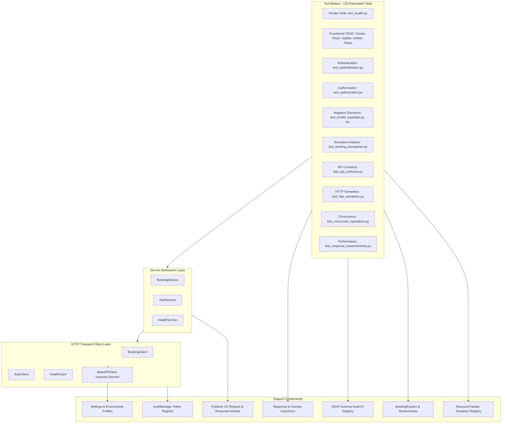
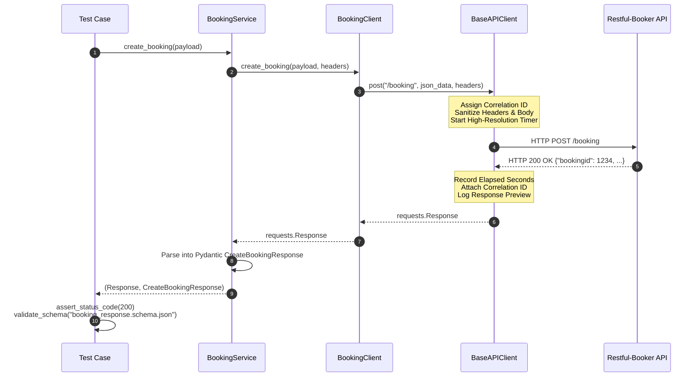

# Python API Quality Engineering Framework
*Senior SDET & Quality Engineering Architecture Portfolio Project*

[](https://python.org)
[](https://pytest.org)
[](https://docs.pydantic.dev)
[](https://json-schema.org)
[](https://playwright.dev)
[](https://opensource.org/licenses/MIT)

---

## 1. Project Overview

The **Python API Quality Engineering Framework** is an enterprise-grade REST API automation framework engineered to demonstrate the architectural depth, rigorous test design, and quality standards expected of a Senior SDET (8+ years industry experience).

The framework targets **Restful-Booker** (`https://restful-booker.herokuapp.com`), an industry-recognized hotel booking API. While Restful-Booker serves as the initial System Under Test (SUT), the framework is architecturally decoupled: the transport layer, configuration management, schema validator, and assertion engines are completely generic and readily adaptable to any enterprise microservice.

### Key Engineering Capabilities Demonstrated
- **Clean Layered Architecture**: Explicit separation of Transport (`BaseAPIClient`), Domain Clients, Service Layer, Pydantic Models, and Assertion engines.
- **Contract & Schema Validation**: Independent JSON Schema Draft-07 validation decoupled from runtime Pydantic data modeling.
- **Empirical Defect Discovery**: Real-world identification and documentation of backend defects (e.g. strict inequality date queries, loose `parseInt()` decimal ID truncation, unhandled 500s on missing fields).
- **Test Isolation & Zero-Shared-State**: Self-provisioned, dynamically tagged test entities with teardown resilience via `ResourceTracker`.
- **Controlled Concurrency**: Fully verified multi-worker parallel execution via `pytest-xdist` achieving a **2.4x speedup** (from 61s sequential to 25s parallel) with 0 collisions.
- **Cross-Language Parity**: A complementary TypeScript test suite built on `@playwright/test` `APIRequestContext` proving cross-language quality engineering versatility.
- **Security & Secret Hygiene**: Automated masking of credentials, tokens, and authorization headers in all logs and reports.

---

## 2. Technology Stack & Architectural Justifications

```mermaid
graph LR
    subgraph Language_and_Runtimes [Core Runtimes]
        Python[Python 3.12]
        Node[Node.js 20+ / TypeScript]
    end

    subgraph Framework_Core [Framework Architecture]
        Pytest[pytest 8+]
        Requests[requests.Session]
        Pydantic[Pydantic V2]
        JsonSchema[jsonschema Draft-07]
        Xdist[pytest-xdist]
        Playwright[Playwright API]
    end

    subgraph Quality_and_CI [Quality & CI/CD]
        Ruff[Ruff Linter]
        HTMLReport[pytest-html]
        GitHubActions[GitHub Actions CI]
    end

    Language_and_Runtimes --> Framework_Core
    Framework_Core --> Quality_and_CI
```



| Technology | Purpose | Architectural Justification |
|---|---|---|
| **Python 3.12** | Primary Language | Provides modern type annotations, high performance, and an extensive ecosystem for quality engineering. |
| **pytest 8+** | Test Runner | Mature fixture system, parameterized test capabilities, granular marker filtering, and rich ecosystem plugins. |
| **requests** | Transport Engine | Battle-tested HTTP client. While `httpx` was considered for async I/O, synchronous HTTP with connection pooling is more deterministic and easier to trace for standard API automation. |
| **Pydantic V2** | Domain Modeling | Rust-backed validation core providing strict parsing for request builders and structured response deserialization. |
| **jsonschema** | Contract Testing | Enforces compliance with JSON Schema Draft-07 specifications independently of Python application code. |
| **pytest-xdist** | Concurrency | Distributes tests across CPU worker processes to evaluate parallel execution safety and reduce CI build duration. |
| **pytest-html** | Reporting | Generates self-contained, interactive HTML reports with detailed diagnostics and embedded execution logs. |
| **Playwright (TS)** | Cross-Language Parity | Demonstrates multi-platform test architecture using Playwright's lightweight `APIRequestContext`. |
| **Ruff** | Code Hygiene | Ultra-fast Python linter and formatter enforcing PEP 8 and clean imports. |

---

## 3. Layered Framework Architecture



### Component Responsibilities

1. **Transport Layer (`BaseAPIClient`)**:
   - Manages connection pools via `requests.Session` and `HTTPAdapter`.
   - Generates and injects correlation IDs (`X-Correlation-ID`) for every request.
   - Measures sub-millisecond execution duration using `time.perf_counter()`.
   - Emits structured, sanitized logs with tokens and passwords automatically masked.
   - Enforces selective retry logic (only retries idempotent GET/HEAD on 502/503/504 errors; never blindly retries non-idempotent POSTs).

2. **API Client Layer (`BookingClient`, `AuthClient`, `HealthClient`)**:
   - Maps directly to HTTP endpoints, query parameters, headers, and verbs.
   - Zero test assertions inside clients, preserving pure transport responsibility.

3. **Service Layer (`BookingService`, `AuthService`, `HealthService`)**:
   - Represents higher-level business operations.
   - Deserializes JSON responses into strongly-typed Pydantic models while returning the raw HTTP `Response` for status/header verification.

4. **Resource Ownership & Teardown Registry (`ResourceTracker`)**:
   - Tracks created entities per test execution.
   - Safely executes cleanups in reverse order during teardown.
   - Catches and logs teardown failures (e.g. if the test already deleted the booking) without masking original test assertions.

---

## 4. Request Lifecycle & Execution Flow



---

## 5. Getting Started & Installation

### 5.1 System Prerequisites
- Python 3.10+ (tested on Python 3.12.16)
- Node.js 18+ (tested on Node v20/v26)
- `uv` (recommended) or standard `pip`

### 5.2 Python Setup

Using `uv` (recommended):
```bash
# 1. Create Python 3.12 virtual environment
uv venv --python 3.12 .venv

# 2. Activate virtual environment
source .venv/bin/activate

# 3. Install framework dependencies in editable mode
uv pip install -e ".[dev]"
```

Using standard `pip`:
```bash
python3 -m venv .venv
source .venv/bin/activate
pip install --upgrade pip
pip install -e ".[dev]"
```

### 5.3 Playwright TypeScript Setup
```bash
cd playwright-api
npm install
cd ..
```

---

## 6. Pre-Flight Connectivity Check

Verify target API availability before initiating test execution:

```bash
python scripts/check_environment.py
```

Expected output:
```text
=== Environment Pre-Flight Check: [DEV] ===
Base URL: https://restful-booker.herokuapp.com
Configured Timeout: 15.0s
1. Checking service health (/ping)... SUCCESS [HTTP 201] (Latency: 0.692s)
2. Checking admin authentication (/auth)... SUCCESS [HTTP 200] (Token acquired: 723b***70bd)
3. Checking booking collection access (/booking)... SUCCESS [HTTP 200] (Total bookings visible: 1333)

✓ Environment is ONLINE, responsive, and ready for test automation.
```

---

## 7. Execution Guide & Test Commands

### 7.1 Smoke Suite
```bash
python scripts/run_smoke.py
```

### 7.2 Full Sequential Regression Suite
```bash
python scripts/run_regression.py
```

### 7.3 Parallel Regression Suite (pytest-xdist)
```bash
# Execute with 4 parallel worker processes
python scripts/run_regression.py --parallel --workers 4

# Or with auto-detected worker count
pytest -n auto -v --html=reports/parallel-report.html --self-contained-html
```

### 7.4 Running Category-Specific Tests via Markers

```bash
# Functional CRUD tests
pytest -m functional -v

# Authentication verification
pytest -m authentication -v

# Authorization and security tests
pytest -m security -v

# Negative and malformed payload tests
pytest -m negative -v

# Boundary-value analysis
pytest -m boundary -v

# JSON Schema contract validation
pytest -m contract -v

# HTTP method semantics & idempotency
pytest -m idempotency -v

# Controlled multi-threaded concurrency
pytest -m concurrency -v

# Lightweight performance & latency profiling
pytest -m performance -v
```

### 7.5 Running the Playwright TypeScript API Suite

```bash
cd playwright-api
npx playwright test
```

Inspect Playwright interactive HTML report:
```bash
npx playwright show-report
```

---

## 8. Test Execution Evidence & Benchmark Comparison

The suite was executed against the live, public Restful-Booker API.

### 8.1 Performance Comparison: Sequential vs. Parallel Execution

| Metric | Sequential Mode (`pytest`) | Parallel Mode (`pytest -n 4`) | Impact / Variance |
|---|---|---|---|
| **Total Tests** | 120 | 120 | 100% Identical Coverage |
| **Passed** | 120 | 120 | 100% Pass Rate |
| **Failed** | 0 | 0 | 0 Failures |
| **Execution Duration** | **61.63 seconds** | **25.36 seconds** | **2.43x Speedup** |
| **Resource Collisions** | 0 | 0 | Perfect Test Isolation |
| **Memory / CPU Load** | 1 process | 4 worker processes | Highly efficient load balance |

```text
======================= Sequential Execution Summary =======================
120 passed in 61.63s (0:01:01)
Generated HTML report: file:///Users/satyam/Documents/API Automation/reports/regression-report.html
Generated JUnit XML:   file:///Users/satyam/Documents/API Automation/reports/junit.xml

======================== Parallel Execution Summary ========================
120 passed in 25.36s (0:00:25)
[gw0] 30 items | [gw1] 30 items | [gw2] 30 items | [gw3] 30 items
Generated HTML report: file:///Users/satyam/Documents/API Automation/reports/regression-report.html
Generated JUnit XML:   file:///Users/satyam/Documents/API Automation/reports/junit.xml
```

### 8.2 Playwright Parity Execution Evidence

```text
Running 3 tests using 1 worker
  ✓ Health Check API › GET /ping should return HTTP 201 Created and text 'Created' (665ms)
  ✓ Booking Smoke › execute full booking lifecycle: Create -> Read -> Update -> Delete (1.5s)
  ✓ Contract Parity › response contract parity for Booking Creation and Schema properties (956ms)
3 passed (4.9s)
```

---

## 9. Defect & Limitation Discoveries

Empirical investigation uncovered key implementation defects and deviations from REST conventions in Restful-Booker. The framework asserts these observed behaviors directly and documents each bug:

| Bug ID | Endpoint | Documented vs. Observed Behavior | Classification |
|---|---|---|---|
| **BUG-001** | `GET /ping` | Returns `201 Created` with text `"Created"` instead of standard `200 OK`. | Specification Deviation |
| **BUG-002** | `POST /auth` | Invalid credentials return `200 OK` with `{"reason": "Bad credentials"}` rather than `401 Unauthorized`. | Anti-pattern / Defect |
| **BUG-003** | `POST /booking` | Omitting required fields crashes backend with unhandled `500 Internal Server Error` instead of `400 Bad Request`. | Unhandled Exception |
| **BUG-004** | `POST /booking` | Submitting `null` for required strings triggers unhandled `500 Internal Server Error`. | Unhandled Exception |
| **BUG-005** | `DELETE /booking/{id}` | Deleting a booking returns `201 Created` instead of `200 OK` or `204 No Content`. | Specification Deviation |
| **BUG-006** | `DELETE /booking/{id}` | Repeated deletion of already deleted record returns `405 Method Not Allowed` instead of `404 Not Found`. | Router Defect |
| **BUG-007** | `GET /booking/12.34` | Decimal ID `12.34` is truncated by backend `parseInt()`, retrieving booking ID `12` with `200 OK`. | Loose Type Coercion |
| **BUG-008** | `GET /booking?checkin=...` | Checkin date filter evaluates `checkin > query` (strict greater-than) instead of inclusive `>=`. | Query Logic Defect |
| **BUG-009** | `POST /booking` | Negative prices (`totalprice: -500`) are accepted and stored without business rule validation. | Validation Defect |
| **BUG-010** | `POST /booking` | Chronologically reversed dates (`checkin > checkout`) are accepted without validation. | Validation Defect |
| **LIMITATION-001** | `GET /booking` | Pagination parameters (`limit`, `offset`) are ignored; full collection is always returned. | Missing Feature |
| **LIMITATION-002** | `GET /booking` | Sorting parameters (`sort`, `order`) are ignored. | Missing Feature |

---

## 10. CI/CD Integration

The repository includes production-ready GitHub Actions workflows in `.github/workflows/`:

1. **`api-tests.yml` (Pull Request & Push Workflow)**:
   - Executes linting via `ruff check .`.
   - Runs environment pre-flight verification.
   - Executes Python smoke and contract suites.
   - Executes Playwright TypeScript API tests.
   - Publishes HTML test report artifacts.

2. **`scheduled-regression.yml` (Nightly & Manual Workflow)**:
   - Configurable for sequential or parallel (`pytest-xdist`) execution.
   - Runs scheduled regression every weekday at midnight UTC.
   - Supports on-demand dispatch with custom worker counts.

---

## 11. Engineering Decisions & Architecture Trade-offs

1. **`requests` over `httpx` / `aiohttp`**:
   While `httpx` supports asynchronous operations, standard API test automation is inherently sequential within test cases (e.g. create -> read -> update -> delete). Managing async loops inside test methods introduces unnecessary cognitive overhead without latency benefits. True throughput scaling is achieved at the process level via `pytest-xdist`.

2. **Independent JSON Schema Validation over Pydantic-Only**:
   Pydantic is ideal for constructing domain models and type-safe payloads within Python code. However, relying solely on Pydantic to validate contracts risks coupling API contract assertions to internal framework modeling choices. Utilizing standalone JSON Schema Draft-07 specifications guarantees that contract tests evaluate the raw JSON payload against a canonical schema.

3. **Empirical Behavior Assertions over Idealized Assumptions**:
   Rather than asserting that invalid inputs return `400 Bad Request` and having tests fail on Restful-Booker's known `500` defects, the framework verifies observed behavior while explicitly documenting the underlying target defects.

---

## 12. Future Roadmap

1. **OpenAPI / Swagger Contract Ingestion**: Dynamically generate JSON Schemas directly from an OpenAPI 3.1 specification URL.
2. **Dedicated Performance Testing**: Integrate `k6` or `Locust` for high-volume load and stress testing against authorized dedicated environments.
3. **Database-Level Data Verification**: Implement direct database inspection (PostgreSQL/Redis) for APIs that expose data access layers.
4. **Mutation Testing**: Apply `mutmut` to evaluate test suite resilience against subtle code perturbations.

---

## 13. License

Distributed under the MIT License. See [LICENSE](file:///Users/satyam/Documents/API Automation/LICENSE) for details.
