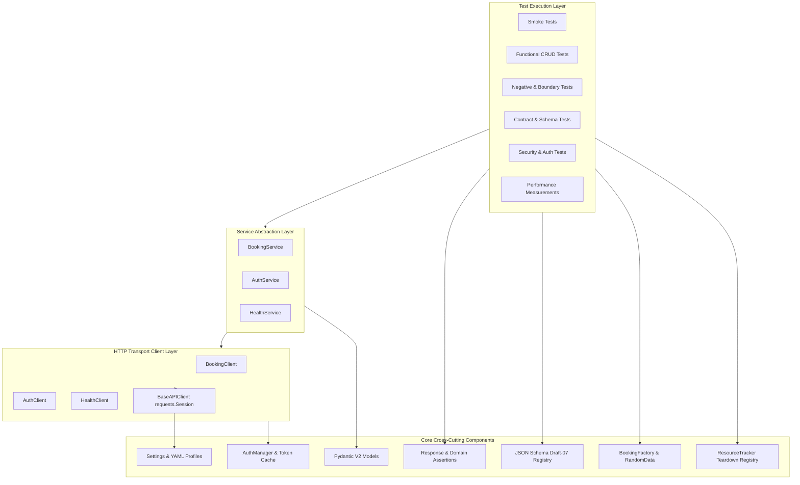
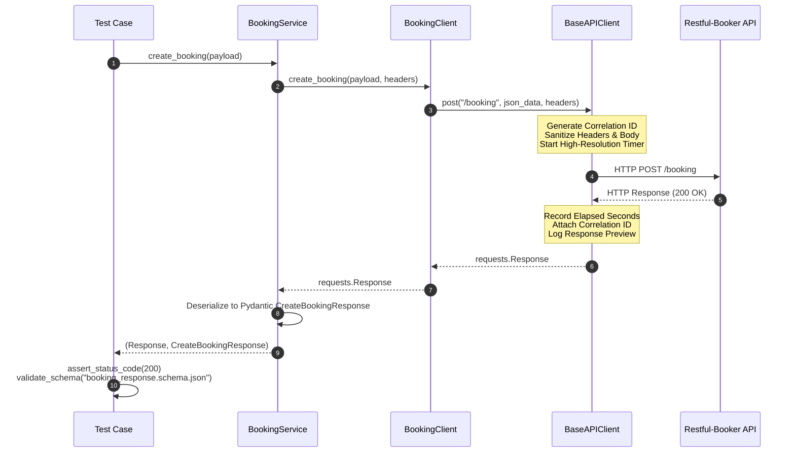
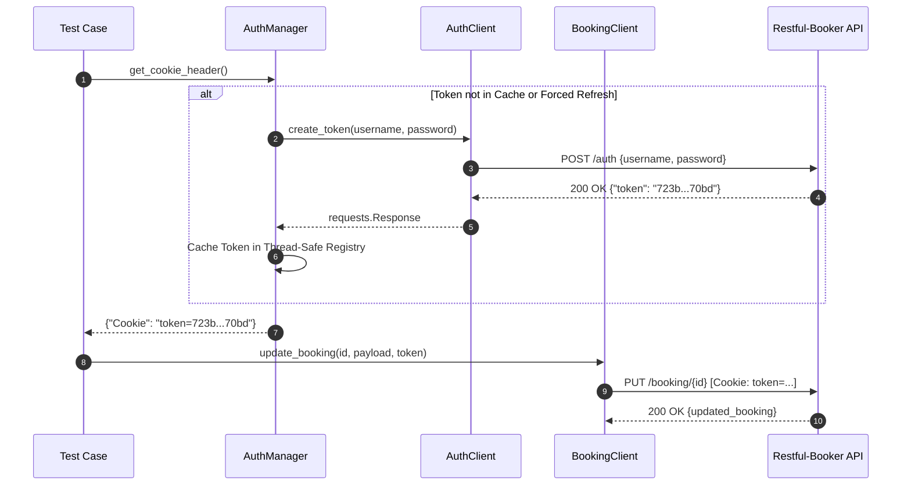
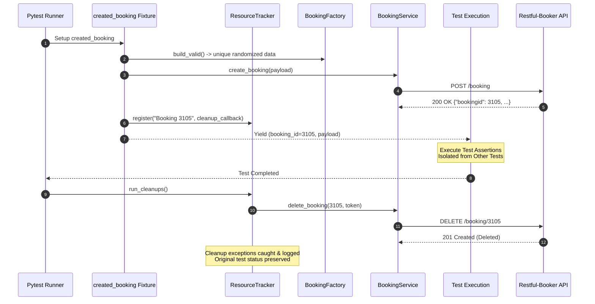

# System Architecture & Technical Design

## 1. Architectural Philosophy

The **API Quality Engineering Framework** is architected according to clean architectural separation of concerns:
- **Maintainability over premature abstraction**: Direct, clear Python abstractions without deep class hierarchies.
- **Transport vs. Business vs. Assertions**: HTTP details are completely decoupled from domain operations, and assertions remain strictly in the test and assertion layers.
- **Strict Test Isolation**: Tests never share mutable state or depend on execution ordering.
- **Comprehensive Diagnostics**: Outgoing requests and incoming responses are intercepted, timed, sanitized, and logged with unique correlation IDs.

---

## 2. High-Level Component Architecture

---

## 3. Request Execution Flow

Every HTTP request traverses a structured lifecycle:

---

## 4. Authentication Flow

Restful-Booker utilizes session token cookies for mutating requests (`PUT`, `PATCH`, `DELETE`) with an HTTP Basic Authentication alternative:

---

## 5. Test Data Lifecycle & Isolation

To guarantee deterministic test execution against a public shared API with automatic data resets:

---

## 6. Technology Justification Matrix

| Technology | Purpose | Justification |
|---|---|---|
| **Python 3.12** | Core Language | Expressive, industry-standard language with rich quality engineering ecosystem. |
| **pytest 8+** | Test Framework | Mature fixture system, parametrized test execution, xdist parallelization, and clean assertions. |
| **requests** | HTTP Transport | Predictable, stable, well-understood transport with explicit connection pooling and adapter configuration. |
| **Pydantic V2** | Data Modeling | Strict schema validation, fast parsing, and separation between request objects and response structures. |
| **jsonschema** | Contract Testing | Independent JSON Schema Draft-07 specification validation, decoupling contracts from Python implementation details. |
| **pytest-xdist** | Concurrency | Multi-process worker distribution for high-throughput parallel test execution. |
| **pytest-html** | Reporting | Self-contained, portable HTML execution reports for stakeholder review and CI artifact archiving. |
| **Playwright (TS)** | Cross-Language Parity | Demonstrates multi-language API automation capabilities using modern TypeScript `APIRequestContext`. |
